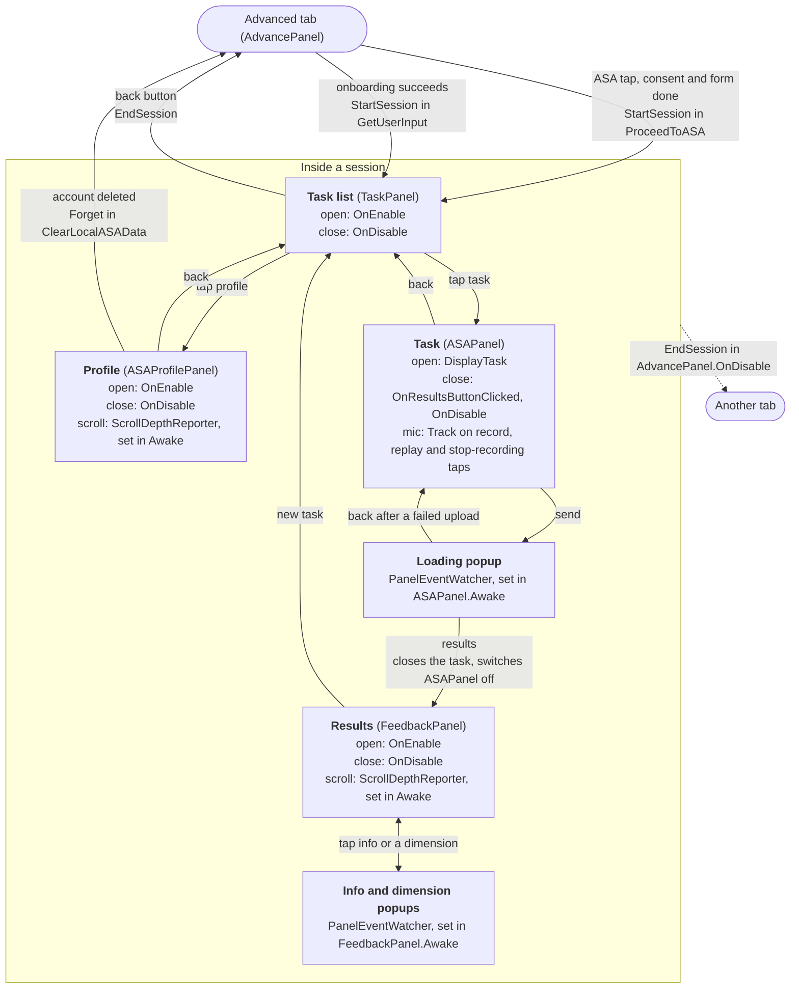

# User Behaviour Events (client)

How the Unity client records what learners do in the Automatic Speaking Assessment (ASA)
and sends it to the server. Server contract: dta-server `docs/USER_EVENTS.md` and
`app/models/events.py`.

Status: first draft. The system is in `Assets/Scripts/UserBehaviour/` and is called from
the ASA screens (see [Wiring](#wiring)).

## How it works

1. **Session.** Events are only recorded inside an ASA session. It starts when the task
   list opens, after a tap on **Automatic Speaking Assessment** or at the end of onboarding
   (`StartSession()` sends `asa_session_started` with a new `asa_session_id`), and ends
   only when they quit: leaving the assessment
   (`EndSession()`), closing the app, or 30 s or more in the background (after which a new
   session starts on the task list). Ending closes any open
   panels, then sends `asa_session_ended`, except after a kill or crash (see
   [Lifecycle](#lifecycle-on-a-phone)). Outside a session every call does nothing.
2. **Record.** Each event is checked against the server's rules (ids ≥ 1, depth 0–1, and
   a dimension in range, since it is cast from a popup index). Invalid ones are logged
   and skipped. Valid ones get an
   `event_id` and a UTC timestamp and are written to `user_events_outbox.json` straight away.

   Only the server checks the rest. An `occurred_at` over 30 days old or over 5 minutes
   ahead of the server clock drops that event, and the batch still gets a normal 202. An
   `app_version` that is over 32 characters or does not match `^[0-9A-Za-z.+-]+$` gets a
   422 for the whole batch.

3. **Send.** At launch, every 60 s, at 20 queued events, when a session ends and when the
   app goes to the background, queued events are posted to `Secret.ASA_EVENTS_URL` in
   batches of ≤ 200. A batch shares one guid, session and app version.
4. **Response.**

   | Status                     | Action                                       |
   | -------------------------- | -------------------------------------------- |
   | 2xx                        | Remove batch.                                |
   | 400/413/415/422, other 4xx | Remove batch, log error (client bug).        |
   | 403/404/409                | Remove batch, log warning (no consent/user). |
   | 5xx, 429, offline          | Keep batch; the next send retries.           |

   A resent event keeps its `event_id`, so the server stores it once.

## Panels

A panel event says _which_ panel and _what it shows_; the manager adds `active`.

- `PanelOpened(p)` sends `active: true`; `PanelClosed<T>()` sends `active: false` with the
  same `task_id`/`dimension`, so the server can pair them into durations.
- Opening a panel that is already open is ignored; opening it with new content (another
  task) closes the old one first. Closing one that is not open is ignored. So calls can
  live in `OnEnable`/`OnDisable`.
- `PanelEventWatcher.Attach(go, () => new LoadingModalToggled(id))` reports a script-less
  popup from its own enable/disable.
- `ScrollDepthReporter.Attach(scrollRect, depth => ...)` reports scroll depth once a
  learner's scroll comes to rest (0 = top, 1 = bottom). Programmatic resets do not count.
- Panels can overlap. The task list stays open behind the profile, and the task panel stays
  open behind the loading popup. So `task_selection_panel_toggled` durations include profile
  time, and `task_panel_toggled` durations include loading. The task panel closes when the
  results open, so its durations do not include results.

## Events

| Event                          | Properties                           | Call                                              |
| ------------------------------ | ------------------------------------ | ------------------------------------------------- |
| `asa_session_started`          | `language` (see below)               | `UserEvents.StartSession()`                       |
| `asa_session_ended`            | `reason`: quit/timeout/error         | `UserEvents.EndSession(reason)`                   |
| `task_selection_panel_toggled` | `active`                             | `PanelOpened(new TaskSelectionPanelToggled())`    |
| `profile_panel_toggled`        | `active`                             | `PanelOpened(new ProfilePanelToggled())`          |
| `task_panel_toggled`           | `active`, `task_id`                  | `PanelOpened(new TaskPanelToggled(id))`           |
| `loading_modal_toggled`        | `active`, `task_id`                  | `PanelOpened(new LoadingModalToggled(id))`        |
| `feedback_panel_toggled`       | `active`, `task_id`, `assessment_id` | `PanelOpened(new FeedbackPanelToggled(id, aid))`  |
| `info_modal_toggled`           | `active`, `task_id`                  | `PanelOpened(new InfoModalToggled(id))`           |
| `dimension_modal_toggled`      | `active`, `task_id`, `dimension`     | `PanelOpened(new DimensionModalToggled(id, dim))` |
| `mic_button_clicked`           | `button_id`, `task_id`               | `Track(new MicButtonClicked(button, id))`         |
| `profile_panel_scrolled`       | `depth`                              | `Track(new ProfilePanelScrolled(depth))`          |
| `feedback_panel_scrolled`      | `depth`, `task_id`                   | `Track(new FeedbackPanelScrolled(depth, id))`     |
| `language_changed`             | `from_language`, `to_language`       | `UserEvents.LanguagePicked(from, to)`             |

`task_id` is the server id (1-based): use `ASAPanel.CurrentServerTaskId`, not the array index.

`language_changed` uses Unity locale codes (`en`, `fi`, `fa`, ...). `LanguageDropdown` calls
`LanguagePicked` on every pick. Inside a session the event is sent at once. A pick outside a
session (the Advanced tab) cannot be sent then, so the manager remembers the language the
server last heard about, and the next session start sends one `language_changed` from it to the
current language, right after `asa_session_started`. Switching back before then sends nothing.

`asa_session_started` also carries `language`, the app language when the session starts,
so every session's language is known even if the learner never changes it. It needs the
server release that accepts the property to be live before the app ships: an older server
rejects an event with an unknown property, so every session start would be lost. To ship
against an older server, set `SendSessionLanguage` in `UserEventManager.cs` to false.

To add an event: copy the closest struct in `UserEventModels.cs`, change `Name`, fields,
`Validate` and `WriteProperties`, and keep it in step with `events.py`.

## Lifecycle on a phone

| Situation                        | What happens                                                                                                                                                               |
| -------------------------------- | -------------------------------------------------------------------------------------------------------------------------------------------------------------------------- |
| App goes to background           | Time it was left saved; queued events sent.                                                                                                                                |
| Back in under 30 s               | Same session continues.                                                                                                                                                    |
| Back after 30 s or more          | Session ends as `timeout` at the time it was left. A new session (new `asa_session_id`) starts on the task list, and `UserEvents.SessionTimedOut` tells the UI to show it. |
| App killed in background / crash | Next launch ends that session as `timeout` at last-seen time.                                                                                                              |
| App quits normally               | Session ends as `quit`.                                                                                                                                                    |
| Account deleted                  | `UserEvents.Forget()` drops the session and queue unsent.                                                                                                                  |
| Offline                          | Events stay queued; max 200 on device, oldest dropped first.                                                                                                               |

After a kill or crash:

- Panels that were open are not closed, because the list of open panels is only in memory.
  The server leaves their `closed_at` and `duration_ms` as NULL.
- Last-seen time is the last recorded event or the time the app was left, and only the time
  the app was left is always written to disk straight away. A crash in the foreground can
  lose the newest value, so the session ends at an older saved time, or at the next launch
  if none was saved.

## Files

| File                                 | Role                                                           |
| ------------------------------------ | -------------------------------------------------------------- |
| `UserEvents.cs`                      | Public API the screens call.                                   |
| `UserEventManager.cs`                | Session, open panels, recording, send loop. Created at launch. |
| `UserEventModels.cs`                 | One struct per server event, plus enums and rules.             |
| `UserEventOutbox.cs`                 | On-device queue (JSON file, max 200).                          |
| `UserEventSender.cs`                 | One HTTP POST; maps status codes to outcomes.                  |
| `Assets/Scripts/Utils/JsonWriter.cs` | Minimal JSON writer for the payload (`SaySuomi.Utils`).        |
| `PanelEventWatcher.cs`               | Reports popup open/close from enable/disable.                  |
| `ScrollDepthReporter.cs`             | Reports scroll depth at rest.                                  |

## Wiring

All of it is in code, so the scene does not change.

Each box is a screen with the calls it owns: "open" is `PanelOpened` and "close" is
`PanelClosed`. Each arrow is something the learner does, with any session call it makes.

- **Start:** not at the tap. A learner still on the consent or background form is not on the
  server yet, so their events would be refused.
- **End:** closing the app is automatic, so it needs no call from a screen.
- **Mic:** `Track(...)` is in `OnRecordButtonClicked`, `OnReplayButtonClicked` and the
  stop-recording button's listener (`pauseButtonGO`). It is not in `StopRecord`, because the
  timer running out and the back button also call that, and only taps count. The stop-replay
  button (`OnStopReplayButtonClicked`) is not tracked.
- **Results:** `OnResultsButtonClicked` closes the task with `PanelClosed`, then switches
  `ASAPanel` off. The close is explicit, so it does not depend on the panel being hidden.
  Closing the first-time info popup on the results switches `ASAPanel` back on, without
  reopening the task event. So the new task handler switches it off again, and no task stays
  active under the task list.
- **Results ids:** the feedback panel and its popups read `task_id` and `assessment_id` from
  `asrResultASA`, the result on screen.
- **Timeout:** `AdvancePanel` subscribes to `UserEvents.SessionTimedOut` in `OnEnable` and
  unsubscribes in `OnDisable`. The handler switches off the current task (`ASAPanelGO`),
  results (`feedbackPanelGO`), the assessment loading popup (`loadingPopUpGO`) and the
  profile, then switches on the task list (`taskPanelGO`). `ASAPanel.OnDisable` cancels a
  recording in progress. The task, results and profile screens each have their own dim panel
  and reset it in `OnEnable`, and the feedback and profile panels also close their popups
  there, so none reappears on the next visit. The task list is different: `LoadingPopUpProfile`
  and its dim panel stay on through a timeout. `NetworkManager` clears them when the profile
  loads, which then opens the profile in the new session, and the popup's back button also
  clears them.
